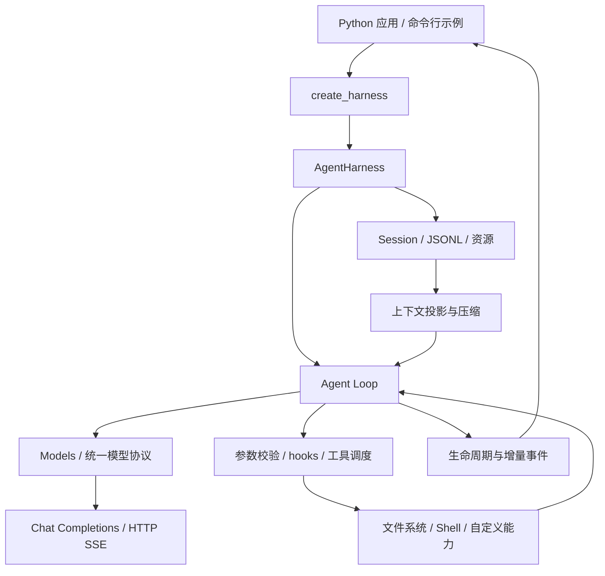

# Aster Harness

**一个可嵌入 Python 应用的轻量 Agent Harness。**

围绕“模型响应 → 工具执行 → 结果回填 → 再次推理”的循环，提供流式事件、工具调度、会话管理和上下文处理能力。应用通过 `create_harness()` 组装模型和工具，也可以使用底层运行时构建自己的 Agent。

项目基于 [pi-agent-core-py](https://github.com/wesleyzhangwq/pi-agent-core-py) 继续开发，以 [Pi](https://github.com/earendil-works/pi) 为架构参考。

## 当前能力

| 层次 | 已实现能力 |
| --- | --- |
| 模型接入 | OpenAI-compatible Chat Completions、HTTP/SSE 流式解析、文本与工具调用生成、可选 reasoning 与 usage |
| Agent Loop | 多轮模型与工具闭环、参数预处理和 Schema 校验、工具前后 hooks、并行／串行工具批 |
| 运行控制 | steering、follow-up、协作式取消、生命周期事件与订阅 |
| SDK | `create_harness()`、自定义工具、可选内置 `read` / `write` / `edit` / `bash` |
| 请求可靠性 | 有界请求重试、超时、取消传播、流式中断处理；已执行的工具不会因 HTTP 重试而重跑 |
| 会话与资源基础 | 树形 Session、JSONL 存储、分支与上下文重建、Skills、提示模板、摘要压缩 |

当前 SDK 默认使用内存 Session。持久化 Session 需要显式组装；底层已有压缩能力，SDK 尚未自动按窗口阈值触发压缩。当前直接接入的模型协议为 Chat Completions，其他协议可通过模型层扩展。

## 快速开始

需要 **Python 3.11+**。在仓库根目录安装：

```bash
git clone https://github.com/handlerzzy/harness.git
cd harness
python -m venv .venv
source .venv/bin/activate
python -m pip install -e ".[dev]"
```

Windows PowerShell 使用 `.venv\Scripts\Activate.ps1` 激活环境。

配置一个支持 Chat Completions 的模型服务，模型名与窗口参数按实际后端填写：

```bash
export MODEL_API_KEY="your-api-key"
export MODEL_BASE_URL="https://your-endpoint.example/v1"
export MODEL_ID="your-model-id"
export MODEL_CONTEXT_WINDOW="128000"
export MODEL_MAX_TOKENS="2048"
```

`MODEL_BASE_URL` 是 API 根地址，不包含 `/chat/completions`。示例从环境变量读取配置，不会自动加载 `.env`。

```bash
python examples/chat.py "请用一句话介绍你自己"
```

在自己的测试工作区启用编码工具：

```bash
python examples/chat.py --tools --cwd /path/to/workspace "读取 README.md，说明项目的入口与主要模块"
```

启用工具后，Agent 可以访问文件并执行 Shell 命令。`cwd` 是路径解析基准；进程隔离和执行权限由宿主应用提供。

## Python SDK

```python
import asyncio
import os

from aster_harness import create_harness


async def main():
    harness = create_harness(
        api_key=os.environ["MODEL_API_KEY"],
        base_url=os.environ["MODEL_BASE_URL"],
        model_id=os.environ["MODEL_ID"],
        context_window=int(os.environ["MODEL_CONTEXT_WINDOW"]),
        max_tokens=int(os.environ["MODEL_MAX_TOKENS"]),
        system_prompt="你是一个简洁的代码助手，根据工具结果回答。",
        cwd=".",
        builtin_tools=True,
    )

    def on_event(event):
        if event["type"] == "message_update":
            update = event["assistantMessageEvent"]
            if update["type"] == "text_delta":
                print(update["delta"], end="", flush=True)

    unsubscribe = harness.subscribe(on_event)
    try:
        result = await harness.prompt("读取 README.md，概括项目的主要能力。")
        print("\n结束状态：", result["stopReason"])
    finally:
        unsubscribe()


asyncio.run(main())
```

同一个 Harness 会复用会话历史。`prompt()` 的结果包含 `stopReason`，调用方应处理 `stop`、`length`、`error` 和 `aborted`；错误信息位于 `errorMessage`。

自定义工具使用 `AgentTool` 声明参数约束与执行函数，再通过 `tools=[...]` 传入。模型生成工具调用的事件与真实工具执行事件相互独立：完整参数通过校验后，运行时才会执行工具。

更多工具示例、请求 hooks、重试边界、取消语义及 Session 组装方式见 [SDK 使用参考](docs/sdk.md)。

## 设计主线



- **模型层负责协议转换。** 供应商响应转换成统一的消息和模型事件，上层循环消费统一协议。
- **工具执行有明确边界。** 参数预处理、校验、前置 hook、执行和后置 hook 串联；工具失败作为结果返回给模型。
- **并行执行与历史顺序分别处理。** 工具完成事件及时发出，结果消息按模型原始调用顺序回填；内置编码工具将整批设为串行，保证写入、编辑和验证的顺序。
- **历史与上下文分离。** Session 保存分支历史，模型请求使用投影后的上下文，压缩围绕保留近期消息与生成摘要展开。
- **观察与控制通过事件和 hooks 接入。** 界面可以消费增量事件，应用可以在执行边界加入自己的策略。

## 代码导航

```text
src/aster_harness/
├── sdk.py                   # 应用组装入口
├── models.py                # 模型访问与统一调用
├── providers/               # Chat Completions 适配器
├── agent.py                 # 有状态 Agent 与控制队列
├── agent_loop.py            # 模型、工具和下一轮的核心循环
├── coding_tools.py          # read / write / edit / bash
├── event_stream.py          # 异步事件流
└── harness/
    ├── agent_harness.py     # 会话、hooks 与生命周期协调
    ├── session/             # 会话树与存储
    ├── compaction/          # 摘要与安全切点
    ├── env/                 # 本地执行环境
    ├── skills.py            # Skill 发现与加载
    └── prompt_templates.py  # 提示模板
examples/chat.py             # 真实模型的命令行调用示例
tests/                       # 运行时、协议和工具回归
```

建议按 `sdk.py → agent_loop.py → coding_tools.py → harness/session/ → harness/compaction/` 阅读。`Agent` 和 `AgentHarness` 是使用底层循环的不同入口，应用组装通常从 `create_harness()` 开始。

## 开发与验证

使用 uv 时，也可以按锁文件安装：

```bash
uv sync --locked --extra dev
uv run ruff format --check src tests examples
uv run ruff check src tests examples
uv run mypy src
uv run pytest -q
uv build
```

测试涵盖事件顺序、工具调度、参数校验、控制队列、Chat Completions 流式协议、取消与请求重试、工具输出处理、会话存储和压缩。CI 配置了 Python 3.11 / 3.12 / 3.13 的检查及构建安装验证。协议测试使用模拟 HTTP 响应，真实模型效果需要在具体后端单独验证。

## 开发方向

- SDK 层的持久化 Session 和资源配置。
- 手动与自动压缩策略的完整接入。
- 更多端到端示例与可复现任务评估。

当前定位是单进程可嵌入 SDK。会话恢复用于重建历史，工具副作用的撤销、外部操作的恰好一次执行和多租户隔离需要应用另行设计。

## 来源与文档

- [SDK 使用参考](docs/sdk.md)
- [命名迁移说明](docs/migration.md)：发行包名 `aster-harness`，导入名 `aster_harness`。
- [NOTICE](NOTICE.md)：原始项目与衍生关系。
- [UPSTREAM](UPSTREAM.md)：Pi `0.80.10` 的固定源码参考。
- [PARITY](PARITY.md)：继承的运行时实现与上游模块对应关系。

本项目采用 [MIT License](LICENSE)，保留 Mario Zechner 与 Wesley Zhang 的原始版权声明。
